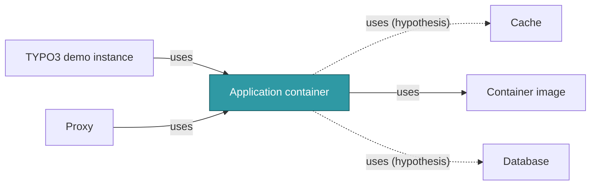

# Definition

The application containers are the services `web`, `worker`, `chat-worker`, `chat-cleanup`, `social-publish`, `vector-compact`, `scheduler` and `alt-text-batch`. All of them start from the container image of this repository with different commands.

# Neighbours

Generated from the relation tables by `check-ontology.py --write-diagrams`. A solid arrow is an asserted relation, a dotted arrow a hypothesis; a slanted box is a file of the repository.

# Relations

| Relation | Target | Evidence file | Evidence text | Status |
|---|---|---|---|---|
| `uses` | [Container image](container-image.md) | `compose.yml` | `dockerfile: docker/web/Dockerfile` | asserted |
| `uses` | [Database](database.md) |  |  | hypothesis |
| `uses` | [Cache](cache.md) |  |  | hypothesis |

# Notes

- The relations to the database and the cache are hypotheses: `compose.yml` names the services and their `depends_on` entries, but no single line in it ties one service to the database or the cache uniquely. All application services start from the image that `compose.yml` builds from `docker/web/Dockerfile`.
