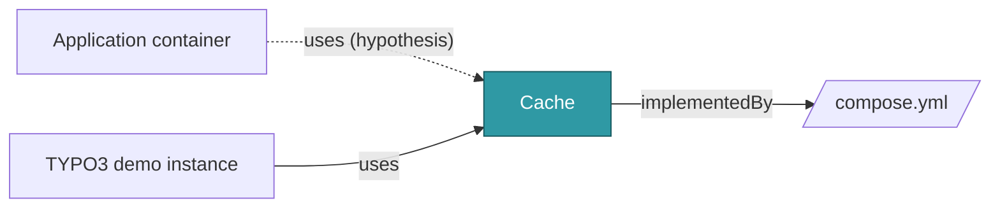

# Definition

The cache is Valkey (`valkey/valkey`), the key-value store the TYPO3 caches use.

# Neighbours

Generated from the relation tables by `check-ontology.py --write-diagrams`. A solid arrow is an asserted relation, a dotted arrow a hypothesis; a slanted box is a file of the repository.

# Relations

| Relation | Target | Evidence file | Evidence text | Status |
|---|---|---|---|---|
| `implementedBy` | `compose.yml` | `compose.yml` | `image: valkey/valkey:` | asserted |
