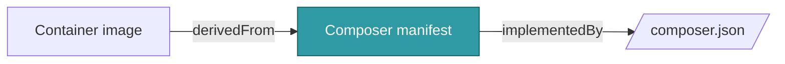

# Definition

The Composer manifest is `composer.json` with the allowed ranges and `composer.lock` with the resolved versions. An extension update on the demo is always a full update of all Netresearch extensions, the lock file and the base images.

# Neighbours

Generated from the relation tables by `check-ontology.py --write-diagrams`. A solid arrow is an asserted relation, a dotted arrow a hypothesis; a slanted box is a file of the repository.

# Relations

| Relation | Target | Evidence file | Evidence text | Status |
|---|---|---|---|---|
| `implementedBy` | `composer.json` | `AGENTS.md` | `An extension update on the demo is always a full update` | asserted |
