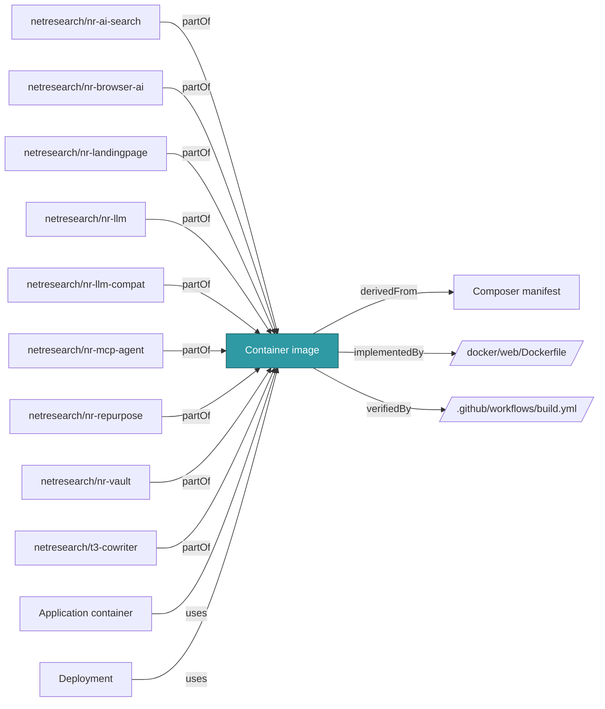

# Definition

The container image `ghcr.io/netresearch/typo3-demo` holds PHP-FPM with nginx, every Composer dependency in the versions of `composer.lock`, and the site package. The build workflow builds it on every pull request and pushes it only from `main`.

# Neighbours

Generated from the relation tables by `check-ontology.py --write-diagrams`. A solid arrow is an asserted relation, a dotted arrow a hypothesis; a slanted box is a file of the repository.

# Relations

| Relation | Target | Evidence file | Evidence text | Status |
|---|---|---|---|---|
| `derivedFrom` | [Composer manifest](composer-manifest.md) | `docker/web/Dockerfile` | `AS composer-builder` | asserted |
| `implementedBy` | `docker/web/Dockerfile` | `docker-bake.hcl` | `dockerfile = "docker/web/Dockerfile"` | asserted |
| `verifiedBy` | `.github/workflows/build.yml` | `.github/workflows/build.yml` | `uses: netresearch/.github/.github/workflows/build-container-bake.yml@main` | asserted |
