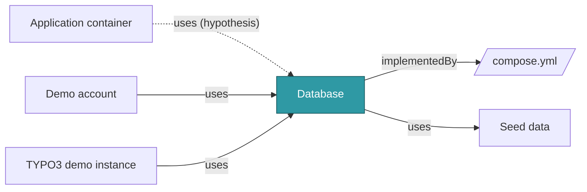

# Definition

The database is MariaDB from the Docker Hardened Image (`dhi.io/mariadb`). Its entrypoint creates no application database, so the one-shot service `db-init` creates the database and the user and imports the seed data on the first boot.

# Neighbours

Generated from the relation tables by `check-ontology.py --write-diagrams`. A solid arrow is an asserted relation, a dotted arrow a hypothesis; a slanted box is a file of the repository.

# Relations

| Relation | Target | Evidence file | Evidence text | Status |
|---|---|---|---|---|
| `uses` | [Seed data](seed-data.md) | `docker/db/init.sh` | `SEED_FILE=/seed/db.sql.gz` | asserted |
| `implementedBy` | `compose.yml` | `compose.yml` | `db: image: dhi.io/mariadb:12` | asserted |
