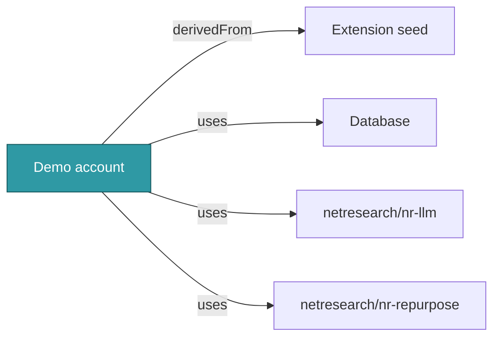

# Definition

The demo accounts are backend users in the database. The admin `nr_admin` comes from the seed data, the editors from the extension seed. `nr_admin` is the administrator. `redakteur_ki` is a non-admin editor with the AI Tasks module and a small AI budget; the module and the Cowriter dialog show its own usage. The other demo editors have no password and are entered through "Switch to user".

# Neighbours

Generated from the relation tables by `check-ontology.py --write-diagrams`. A solid arrow is an asserted relation, a dotted arrow a hypothesis; a slanted box is a file of the repository.

# Relations

| Relation | Target | Evidence file | Evidence text | Status |
|---|---|---|---|---|
| `uses` | [netresearch/nr-repurpose](extensions/nr-repurpose.md) | `data/seed-extensions.sql` | `grants an nrrepurpose option to redakteur_repurpose` | asserted |
| `uses` | [netresearch/nr-llm](extensions/nr-llm.md) | `README.md` | `a non-admin with the AI Tasks module and a` | asserted |
| `uses` | [Database](database.md) | `README.md` | `(run once after a fresh install or reset)` | asserted |
| `derivedFrom` | [Extension seed](extension-seed.md) | `data/seed-extensions.sql` | `WHERE uid = 1000 AND username = 'redakteur_ki' AND admin = 0` | asserted |
