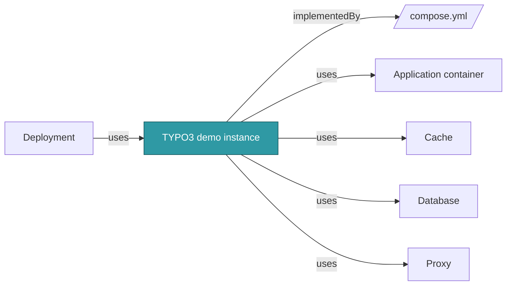

# Definition

The demo instance is the live, disposable TYPO3 14 showcase of the Netresearch extension suite at https://typo3-demo.netresearch.de/. It runs the same container stack in local development and in production.

# Not to be confused with

- The TYPO3 AI Edition. The edition is a Composer package of tested versions; this instance requires the extensions individually.

# Neighbours

Generated from the relation tables by `check-ontology.py --write-diagrams`. A solid arrow is an asserted relation, a dotted arrow a hypothesis; a slanted box is a file of the repository.

# Relations

| Relation | Target | Evidence file | Evidence text | Status |
|---|---|---|---|---|
| `uses` | [Application container](app-container.md) | `compose.yml` | `dockerfile: docker/web/Dockerfile` | asserted |
| `uses` | [Database](database.md) | `compose.yml` | `- typo3-db-v2:/var/lib/mysql` | asserted |
| `uses` | [Cache](cache.md) | `compose.yml` | `image: valkey/valkey:` | asserted |
| `uses` | [Proxy](proxy.md) | `compose.yml` | `image: dhi.io/caddy:` | asserted |
| `implementedBy` | `compose.yml` | `compose.yml` | `name: typo3-demo` | asserted |
