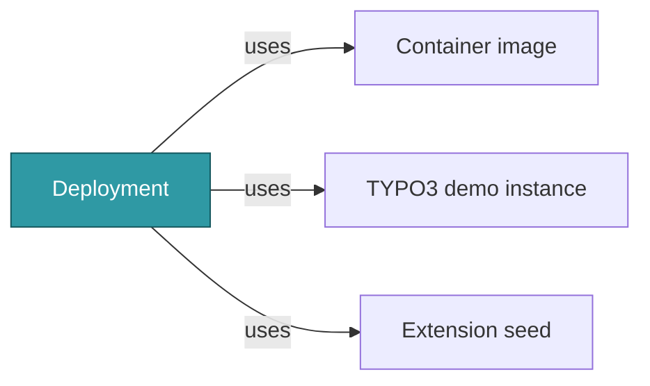

# Definition

Deployment is GitOps-driven: a merge to `main` builds and pushes the container image, and the workflow "Deploy (Update)" runs after a successful build and updates the host. Nobody edits the server by hand.

# Neighbours

Generated from the relation tables by `check-ontology.py --write-diagrams`. A solid arrow is an asserted relation, a dotted arrow a hypothesis; a slanted box is a file of the repository.

# Relations

| Relation | Target | Evidence file | Evidence text | Status |
|---|---|---|---|---|
| `uses` | [Container image](container-image.md) | `.github/workflows/update.yml` | `workflows: ["Build"]` | asserted |
| `uses` | [Extension seed](extension-seed.md) | `.github/workflows/update.yml` | `docker compose version make update` | asserted |
| `uses` | [TYPO3 demo instance](demo-instance.md) | `.github/workflows/update.yml` | `name: Deploy (Update)` | asserted |
