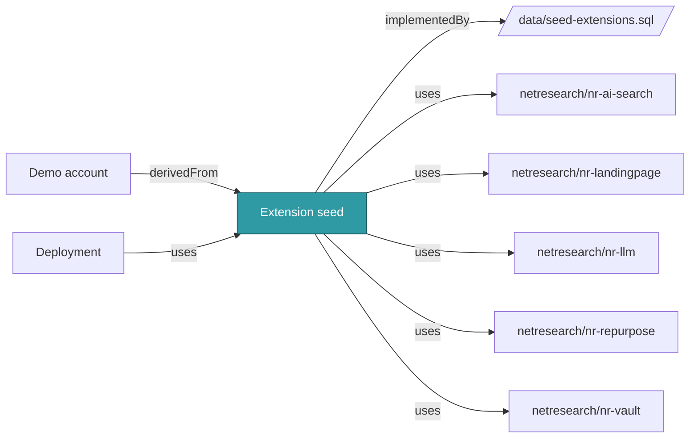

# Definition

The extension seed is `data/seed-extensions.sql` with `data/seed-falkenquell.sql`. It holds the records the extensions need on the demo: the landing-page templates, the dashboards, the demo editors (`redakteur_entwurf`, `redakteur_repurpose`, `redakteur_ki`) and the nr-llm records. `make seed-extensions` applies it idempotently, and `make update`, which the deployment runs, calls it on every deploy. The rule holds per column. A value that the file writes with `UPDATE` or `ON DUPLICATE KEY UPDATE` reaches the live database with the next deploy. A value that it writes only in an `INSERT IGNORE` statement reaches only a database that lacks the row, so a changed value there stays unchanged on the live instance. `data/seed-falkenquell.sql` holds only `INSERT IGNORE` statements.

# Not to be confused with

- The seed data (`data/db.sql.gz`), which is imported only into an empty database.

# Neighbours

Generated from the relation tables by `check-ontology.py --write-diagrams`. A solid arrow is an asserted relation, a dotted arrow a hypothesis; a slanted box is a file of the repository.

# Relations

| Relation | Target | Evidence file | Evidence text | Status |
|---|---|---|---|---|
| `implementedBy` | `data/seed-extensions.sql` | `Makefile` | `seed-extensions: ## Apply data/seed-extensions.sql and data/seed-falkenquell.sql to the DB` | asserted |
| `uses` | [netresearch/nr-llm](extensions/nr-llm.md) | `data/seed-extensions.sql` | `SELECT 'SEED-PROBLEM: tx_nrllm_user_budget 9304 for redakteur_ki (be_user 1000) missing, foreign or inactive'` | asserted |
| `uses` | [netresearch/nr-landingpage](extensions/nr-landingpage.md) | `data/seed-extensions.sql` | `SEED-PROBLEM: tx_nrlandingpage_domain_model_template ` | asserted |
| `uses` | [netresearch/nr-vault](extensions/nr-vault.md) | `data/seed-extensions.sql` | `SEED-PROBLEM: be_users 989 nr_vault_auditor` | asserted |
| `uses` | [netresearch/nr-repurpose](extensions/nr-repurpose.md) | `data/seed-extensions.sql` | `SEED-PROBLEM: be_users 998 redakteur_repurpose` | asserted |
| `uses` | [netresearch/nr-ai-search](extensions/nr-ai-search.md) | `data/seed-extensions.sql` | `SEED-PROBLEM: be_users 990 nr_ai_search_technical` | asserted |
