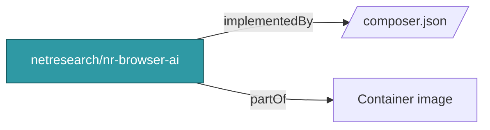

# Definition

The package `netresearch/nr-browser-ai` (On-device page assistant in the browser) as this instance installs it. `composer.json` names the allowed range and `composer.lock` the version the image contains. The instance requires the package directly, so its version can differ from the range the TYPO3 AI Edition tested it in as a suggested member.

# Neighbours

Generated from the relation tables by `check-ontology.py --write-diagrams`. A solid arrow is an asserted relation, a dotted arrow a hypothesis; a slanted box is a file of the repository.

# Relations

| Relation | Target | Evidence file | Evidence text | Status |
|---|---|---|---|---|
| `partOf` | [Container image](../container-image.md) | `composer.lock` | `"name": "netresearch/nr-browser-ai",` | asserted |
| `implementedBy` | `composer.json` | `composer.json` | `"netresearch/nr-browser-ai": "^` | asserted |
