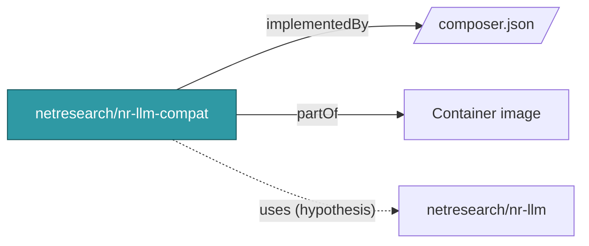

# Definition

The package `netresearch/nr-llm-compat` (Routes LLM calls of third-party AI extensions through nr-llm) as this instance installs it. `composer.json` names the allowed range and `composer.lock` the version the image contains. The instance requires the package directly, so its version can differ from the range the TYPO3 AI Edition tested it in as a suggested member.

# Neighbours

Generated from the relation tables by `check-ontology.py --write-diagrams`. A solid arrow is an asserted relation, a dotted arrow a hypothesis; a slanted box is a file of the repository.

# Relations

| Relation | Target | Evidence file | Evidence text | Status |
|---|---|---|---|---|
| `partOf` | [Container image](../container-image.md) | `composer.lock` | `"name": "netresearch/nr-llm-compat",` | asserted |
| `implementedBy` | `composer.json` | `composer.json` | `"netresearch/nr-llm-compat": "^` | asserted |
| `uses` | [netresearch/nr-llm](nr-llm.md) |  |  | hypothesis |

# Notes

- The `uses` rows are hypotheses: the `require` block of `netresearch/nr-llm-compat` in `composer.lock` names `netresearch/nr-llm`. The rows are not asserted, because the only literal that names the dependency is its version constraint, which changes with every release of the package and would make the check fail on each lock update.
