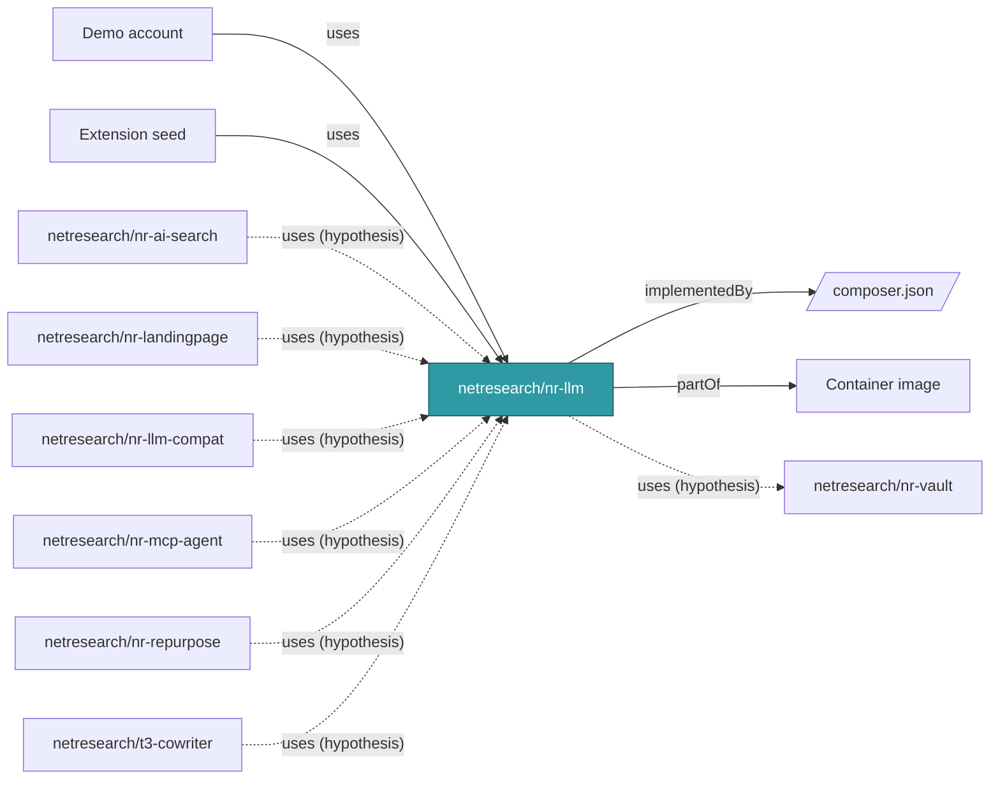

# Definition

The package `netresearch/nr-llm` (LLM foundation: providers, models, configurations, chat, embeddings) as this instance installs it. `composer.json` names the allowed range and `composer.lock` the version the image contains. The instance requires the package directly, so its version can differ from the version the TYPO3 AI Edition tested.

# Neighbours

Generated from the relation tables by `check-ontology.py --write-diagrams`. A solid arrow is an asserted relation, a dotted arrow a hypothesis; a slanted box is a file of the repository.

# Relations

| Relation | Target | Evidence file | Evidence text | Status |
|---|---|---|---|---|
| `partOf` | [Container image](../container-image.md) | `composer.lock` | `"name": "netresearch/nr-llm",` | asserted |
| `implementedBy` | `composer.json` | `composer.json` | `"netresearch/nr-llm": "^` | asserted |
| `uses` | [netresearch/nr-vault](nr-vault.md) |  |  | hypothesis |

# Notes

- The `uses` rows are hypotheses: the `require` block of `netresearch/nr-llm` in `composer.lock` names `netresearch/nr-vault`, but the same constraint text occurs in several packages there, so no literal occurs exactly once.
