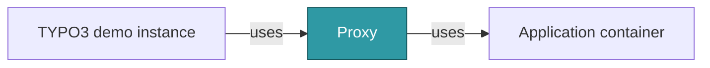

# Definition

The proxy is Caddy (`dhi.io/caddy`), which terminates HTTPS and forwards requests to the web container.

# Neighbours

Generated from the relation tables by `check-ontology.py --write-diagrams`. A solid arrow is an asserted relation, a dotted arrow a hypothesis; a slanted box is a file of the repository.

# Relations

| Relation | Target | Evidence file | Evidence text | Status |
|---|---|---|---|---|
| `uses` | [Application container](app-container.md) | `docker/caddy/Caddyfile` | `reverse_proxy web:80 {` | asserted |
