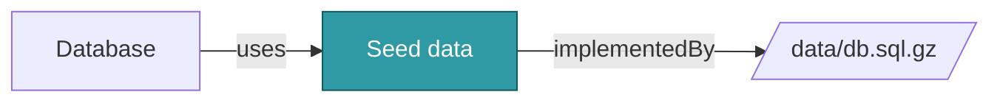

# Definition

The seed data is the database dump `data/db.sql.gz`. It holds the demo content and the admin account `nr_admin`. The service `db-init` imports it only into a database without tables, so live data always wins. A workflow exports a sanitized dump from the live instance. The records the extensions need come from the extension seed.

# Neighbours

Generated from the relation tables by `check-ontology.py --write-diagrams`. A solid arrow is an asserted relation, a dotted arrow a hypothesis; a slanted box is a file of the repository.

# Relations

| Relation | Target | Evidence file | Evidence text | Status |
|---|---|---|---|---|
| `implementedBy` | `data/db.sql.gz` | `.github/workflows/export-seed.yml` | `name: Export DB Seed` | asserted |
